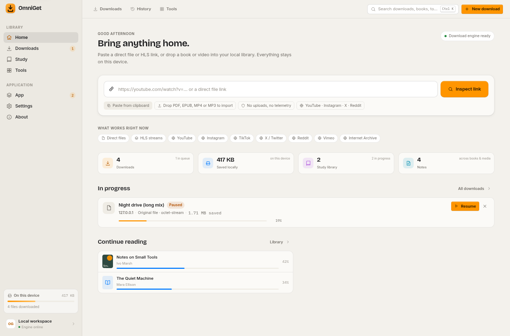
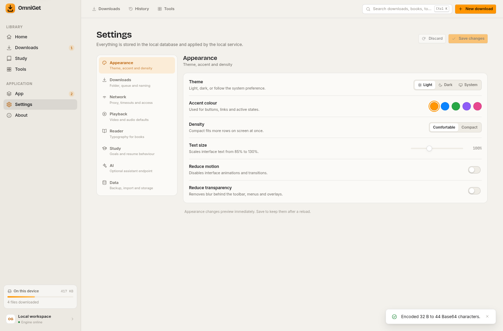

# OmniGet Desktop

A local-first download manager, study library, media player and document toolbox
that runs entirely on your own machine. No account, no cloud sync, no invented
progress bars.

OmniGet is an independent implementation inspired by the interface and scope of
[OpenSelena/omniget](https://github.com/OpenSelena/omniget) (GPL-3.0). This build
is **not** the upstream Tauri application: it is a Node.js service plus a Svelte
single-page client, served over loopback. The mascot, logo, copy and application
code here are original work.



## What is inside

### Downloads

- URL inspection before download: direct files, redirects, unencrypted HLS
  playlists (variant selection), and `yt-dlp` extraction for public page URLs.
- **Working social video downloads** for YouTube, Instagram, X/Twitter, Reddit,
  TikTok, Vimeo, Facebook and the other extractors yt-dlp ships. The quality
  picker is built from the formats the site actually returns:
  - already-muxed progressive files are offered as-is;
  - separate video + audio streams are offered as merged choices when `ffmpeg`
    is present, preferring H.264/MP4 so the result plays everywhere;
  - without `ffmpeg` the video-only formats are hidden rather than silently
    producing a mute file.
- Portrait clips (Instagram Reels, Reddit) are labelled by their short side
  ("720p") while the selector keeps the real pixel height.
- Reddit videos are resolved anonymously through the post's public Atom feed to
  the `v.redd.it` HLS stream, then merged by yt-dlp. No account is used.
- A real queue with configurable concurrency, speed limiting, pause, resume,
  cancel, retry, skip-existing, filename templates and organise-by-source.
  Pause stops the extractor with `SIGINT`; resume continues the same partial
  file with `yt-dlp --continue`, and the progress bar aggregates the separate
  video and audio downloads into one figure.
- Live progress over Server-Sent Events, per-file logs, history, reveal/open
  actions, and byte-for-byte verification in the test suite.
- Media and PDF/EPUB downloads are automatically imported into the local
  library.

#### Social source matrix

| Source | Public post | Needs `ffmpeg` | Notes |
| --- | --- | --- | --- |
| YouTube | Yes | For >360p and VP9/AAC merges | Prefers H.264 + AAC MP4; 144p/240p also work |
| Instagram | Yes (public Reel/post) | Yes (DASH video + audio) | Private/age-gated needs your cookies file |
| X / Twitter | Yes | No for progressive MP4s | HD HLS renditions merge with ffmpeg |
| Reddit | Yes, via Atom feed → `v.redd.it` HLS | Yes | Anonymous; no Reddit account used |
| TikTok / Vimeo / Facebook | Yes | Usually | Handled by yt-dlp |

Verified end-to-end in this repository against real public URLs; the produced
files were inspected with `ffprobe` to confirm both a video and an audio stream.

### Study library

- PDF rendering with PDF.js (local worker) and page navigation, zoom and
  continue-reading.
- EPUB import/unpacking with metadata, cover art, navigation and chapter HTML
  sanitised in a server-side pass. Chapters render inside a shadow root.
- Notes and bookmarks anchored to books, pages, chapters, media timestamps or
  downloads. Reading progress, study seconds and a daily goal persist in SQLite.

### Media player

- Custom audio/video player with a seek bar, volume, speed, loop, keyboard
  controls, resume positions, subtitles (SRT/VTT upload and rendering),
  timestamped notes and bookmarks.
- Playback uses the browser's codecs; unsupported files fail honestly rather
  than pretending to play.

### Document toolbox

43 tools across 12 categories, all executed locally against real files:

| Category | Examples |
| --- | --- |
| PDF | merge, split, extract pages, rotate, metadata, info, PDF → text, images → PDF |
| Documents | text → PDF, Markdown → HTML |
| Text & data | Base64, JSON, CSV → JSON, regex replace, stats, UUIDs, timestamps, colours, JWT, URL codec, line tools |
| Archives | create/list/extract ZIP |
| Speech & subtitles | SRT ↔ VTT, shift, clean, merge, stats |
| Images | resize, convert, crop, info, QR generate/decode |
| Study | EPUB → text |
| Audio | media info, extract audio (ffmpeg) |
| Files | file info and checksums |
| Utilities / CTF | hashing, inspection helpers |
| AI | optional OpenAI-compatible text tool |
| Downloads | download a URL into the output area |

Tools that need `ffmpeg`, `ffprobe` or `yt-dlp` report themselves as unavailable
until those binaries exist on the host. Nothing is silently faked.

### Settings and data

Theme, accent, density, interface scale, reduced motion/transparency, download
folder, concurrency, speed limit, filename template, proxy, timeouts, user
agent, local-address access, TLS verification, playback defaults, reader
typography, study goal, optional AI endpoint and data export/import/reset.



## Requirements

- Node.js **22.5 or newer** (the service uses the built-in `node:sqlite`).
- npm.
- `yt-dlp` for YouTube, Instagram, X/Twitter and Reddit video downloads. This
  build was verified with yt-dlp `2026.10.26`.
- `ffmpeg` for merging separate video + audio streams (required for HD YouTube,
  Reddit and most Instagram/X formats) and for the audio/image tools. Verified
  with ffmpeg `6.1`.
- Optional: `ffprobe` for the media-info tool. ZIP and PDF work is implemented
  in JavaScript.
- Chromium is only needed for the browser test suite and screenshot script.

```bash
# Debian/Ubuntu
sudo apt install ffmpeg
python3 -m pip install --user -U yt-dlp

# Alpine
sudo apk add ffmpeg
pip install --break-system-packages -U yt-dlp

# macOS
brew install ffmpeg yt-dlp
```

OmniGet never downloads or installs these itself. If a binary is missing, the
affected source is marked unavailable and the probe explains exactly what to
install. `ffprobe` is normally installed alongside `ffmpeg`.

## Quick start

```bash
npm install
npm run build
npm start
```

Open <http://127.0.0.1:4173>.

For development, run the API and the Vite dev server in two terminals:

```bash
npm run dev          # Node service on 127.0.0.1:4173
npm run dev:client   # Vite on 127.0.0.1:5173, /api proxied to 4173
```

### Environment variables

| Variable | Default | Purpose |
| --- | --- | --- |
| `PORT` | `4173` | HTTP port |
| `HOST` | `127.0.0.1` | Bind address (keep loopback unless you know why) |
| `OMNIGET_DATA_DIR` | `./data` | Database, downloads, library, outputs and temp files |
| `OMNIGET_ALLOW_LOCAL` | unset | Allow private/loopback download targets (also a saved setting) |
| `OMNIGET_FFMPEG` | `ffmpeg` | Override the ffmpeg binary |
| `OMNIGET_FFPROBE` | `ffprobe` | Override the ffprobe binary |
| `OMNIGET_YTDLP` | `yt-dlp` | Override the yt-dlp binary |
| `OMNIGET_ACCESS_LOG` | unset | Set to `1` to log API requests |

## Data layout

```
data/
  omniget.db          SQLite database (settings, downloads, books, media, notes…)
  downloads/          completed downloads (or your configured folder)
  library/books/      unpacked/imported books and covers
  library/media/      imported audio and video
  library/subtitles/  uploaded subtitle tracks
  outputs/            tool job results, addressed as /api/outputs/<job>/<file>
  tmp/                temporary uploads
```

The database is the source of truth for settings and metadata. Files are never
uploaded anywhere; exports are downloaded as JSON from the Data settings tab or
`/api/data/export`.

## Security and privacy

- The server binds to `127.0.0.1` by default and has no remote account system.
  Treat it as a single-user local service; do not expose it to the internet.
- Outbound probes and downloads block loopback/private/link-local hosts unless
  local access is explicitly enabled, and redirects are re-checked. TLS
  verification is on by default.
- File paths are normalised and confined to managed roots. Uploads and archive
  entries are validated before use; EPUB/HTML chapter content is sanitised.
- The UI applies a restrictive Content Security Policy; PDF.js runs with its
  local worker, and EPUB chapters use a shadow root.
- No telemetry. The only outbound traffic is a download, probe, optional AI
  request or remote thumbnail you explicitly trigger.
- DRM, paywalls, logins and access controls are not bypassed. Supported scope is
  direct HTTP(S) files, unencrypted HLS and public-page extraction through
  `yt-dlp`.
- Public social posts are fetched anonymously. If a site asks for a signed-in
  session for content **you already have access to** (private Instagram posts,
  protected X posts, Reddit posts that refuse anonymous access), you can point
  Settings → Network at a Netscape-format `cookies.txt` exported from your own
  browser. The file is read only by `yt-dlp`, is validated on save, and is never
  sent anywhere else. It cannot unlock content your account cannot see.

## API overview

All endpoints are JSON unless noted. Errors use `{ "error": "...", "code": "..." }`
with meaningful HTTP statuses.

| Area | Endpoints |
| --- | --- |
| System | `GET /api/health`, `GET /api/system`, `GET /api/stats` |
| Events | `GET /api/events` (SSE: snapshot, download progress/log/completed, imports) |
| Settings | `GET/PUT /api/settings`, `POST /api/settings/reset`, `GET /api/settings/export`, `POST /api/settings/import`, `POST /api/settings/test-ai` |
| Downloads | `GET/POST /api/downloads`, `POST /api/downloads/bulk`, `GET/DELETE /api/downloads/:id`, `GET /api/downloads/:id/file`, `GET /api/downloads/:id/logs`, `GET /api/downloads/:id/outputs`, `POST /api/downloads/:id/{pause,resume,cancel,retry,reveal}` |
| Probing | `POST /api/probe`, `GET /api/sources` |
| History | `GET/DELETE /api/history` |
| Library | `GET /api/books`, `POST /api/books/import`, `GET/PATCH/DELETE /api/books/:id`, `GET /api/books/:id/{file,cover,chapter/:idx,asset/*}`, bookmark routes |
| Media | `GET /api/media`, `POST /api/media/import`, `GET/PATCH/DELETE /api/media/:id`, `GET /api/media/:id/file`, subtitle routes |
| Notes | `GET/POST /api/notes`, `PATCH/DELETE /api/notes/:id` |
| Bookmarks | `GET/POST /api/bookmarks`, `DELETE /api/bookmarks/:id` |
| Tools | `GET /api/tools`, `GET/DELETE /api/tools/jobs`, `GET /api/tools/jobs/:id`, `POST /api/tools/:id/run`, `GET /api/outputs/:jobId/*` |
| Filesystem | `GET /api/fs/list`, `POST /api/fs/mkdir`, `POST /api/fs/reveal` |
| Data | `GET /api/data/export`, `GET /api/data/size`, `POST /api/data/clear-history` |

`POST /api/settings` bodies are `{ "settings": { ...partial patch... } }`. The
server deep-merges and clamps values, rejects unusable download folders with
`422`, and returns the complete effective settings object.

## Keyboard shortcuts

| Keys | Action |
| --- | --- |
| `Ctrl` / `⌘` + `K` | Command palette |
| `Space` | Play / pause media |
| `J` / `L` | Seek backward / forward |
| `M` | Mute |
| `F` | Fullscreen |
| `N` | Toggle notes |
| `C` | Toggle subtitles |
| `Esc` | Close dialogs, palette and overlays |

## Testing

The suite is integration-first. It starts the real server against a temporary
data directory, uses a real SQLite database and a real fixture HTTP server, and
checks the bytes that come out.

```bash
npm test        # 30 backend + tool + yt-dlp bridge tests
npm run test:ui # builds, then 9 Chromium tests against the production bundle
```

The browser suite needs Chromium. Set `CHROMIUM_PATH` if it is not at
`/usr/bin/chromium`.

What the tests actually verify includes:

- settings validation, clamping, export/import and reset;
- SSRF blocking of local/private targets until enabled;
- direct downloads writing exactly the fixture bytes, plus real logs/history
  and safe headers for non-ASCII filenames;
- pause freezing byte progress and resume issuing a non-zero `Range` request;
- cancel removing partial files;
- notes/bookmarks/progress/study-time persistence;
- PDF and EPUB import, deduplication by hash and HTML sanitisation;
- media import, position tracking and subtitle conversion;
- ZIP/PDF/image/QR/text tool outputs opened and inspected byte-for-byte;
- unavailable dependencies answering `503`/`409` rather than pretending;
- yt-dlp format/quality selection for muxed, merged-HD, X progressive,
  portrait Instagram and Reddit HLS format shapes;
- the social probe flow on a 390 px viewport: quality choices render, the page
  never scrolls sideways, and the chosen selector is what gets posted;
- navigation, keyboard palette, real tool output, settings round-trip, PDF
  canvas paint, audio metadata/playback, notes editing and mobile layout.

### Fixtures and screenshots

```bash
npm run fixtures    # real seeded dataset in data/fixtures
npm run screenshots # builds, seeds a fresh dataset, captures screenshots/
```

`make-fixtures` starts the real service, serves files from a local HTTP fixture,
downloads them through the queue, imports an EPUB, pauses one long transfer and
adds genuine notes, bookmarks, reading progress and a QR tool run. It never
writes UI state directly. The `screenshots` script then drives Chromium through
the production build and writes desktop and mobile captures under
`screenshots/`.

To run the app against the seeded dataset:

```bash
OMNIGET_DATA_DIR=./data/fixtures npm start
```

## Architecture

```
src/
  App.svelte, main.js          SPA shell, hash routing, hash fallback
  lib/state.svelte.js          Global runes state, boot, SSE, toasts, appearance
  lib/api.js, router.js        Fetch client and route matching
  screens/                     Home, Downloads, History, Study, Reader, Media,
                               Player, Tools, ToolDetail, Settings, About, Notes
  components/                  Sidebar, Toolbar, CommandPalette, rows, dialogs…
server/
  index.js                     HTTP API, SSE, multipart uploads, ranged files
  db.js                        SQLite schema, repositories, stats
  downloader.js                Queue, engine, Range resume, HLS, yt-dlp bridge
  probe.js / net.js / hls.js   Source detection and SSRF-safe transport
  books.js / library.js        EPUB/PDF import, sanitised chapters, media library
  tools/                       Tool registry, runner and implementations
  settings.js                  Defaults, validation, merge, export/import
```

- Svelte 5 runes and a single global app state; no router dependency, no UI kit.
- The API serves the built `dist/` and the same-origin API from one port.
- Downloads and tool jobs emit SSE events; long operations do not poll.
- Persistence is SQLite via `node:sqlite`; files live under the data directory.

## Known limitations

- This is a local web application served by Node.js, not a signed native desktop
  bundle. It runs in your browser against `127.0.0.1`.
- DRM, paywalls, logins and access controls are never bypassed. Your options are
  public extraction or your own cookies file for content you can already watch.
- Social extraction depends on `yt-dlp`. When a site changes, update yt-dlp
  (`pip install -U yt-dlp`, or `yt-dlp -U` for the standalone binary) and
  restart OmniGet; the app cannot patch the extractor itself.
- HD merges, and therefore every Reddit and most Instagram downloads, need
  `ffmpeg`. Without it only single-file progressive formats are listed.
- Reddit's anonymous JSON API is rate-limited and often returns `403`. OmniGet
  resolves public videos through the Atom feed instead; if a post's feed still
  exposes no `v.redd.it` media (image posts, external hosts, quarantined or
  sign-in-only communities) the probe fails honestly instead of guessing.
- Some Instagram reels, age-gated posts and protected X accounts require a
  signed-in session. That is what the cookies file is for; it is not a bypass.
- DASH-only manifests are not downloaded natively. They work when yt-dlp
  supports the page, which covers the sites the UI advertises.
- Media conversion, extract-audio and page extraction depend on `ffmpeg`,
  `ffprobe` and `yt-dlp` being installed on the host.
- Playback support follows the browser: MKV, HEVC and AC-3 files may not decode
  even though they can be stored and downloaded.
- Remote thumbnails are not generated; the media grid uses local artwork or a
  typographic fallback.
- No native file dialog is available through the browser in this build, so
  uploads use the browser picker and the download-folder chooser browses the
  server-side filesystem.

## Licence

Copyright (C) 2026 the OmniGet Desktop contributors.

This program is free software: you can redistribute it and/or modify it under
the terms of the **GNU General Public License, version 3 or later**. The full
text is in [LICENSE](LICENSE). Third-party components and optional binaries keep
their own licences; see [NOTICE](NOTICE) for attribution, including the upstream
[OpenSelena/omniget](https://github.com/OpenSelena/omniget) project whose GPL-3.0
scope inspired this implementation.
